# Чисте небо

Аналіз і прогноз якості повітря (PM2.5 / AQI) у містах України на відкритих даних SaveEcoBot. Є інтерактивний сайт на Streamlit і скрипт, який будує звіт із графіками.

**Дані: [SaveEcoBot](https://www.saveecobot.com/), ліцензія CC BY 4.0.**

## Що вміє

- **Сайт** (`app.py`): вибір міста, картка «Зараз» (AQI, категорія, порада «закрий вікна», найкраща година для вулиці), три вкладки: «Прогноз», «Закономірності», «Порівняння міст».
- **Звіт** (`report.py`): 14 графіків у `outputs/plots/` і текстовий підсумок `outputs/reports/summary.txt`.
- **Аналітика**: профілі за годиною й днем тижня, теплокарти, сезонність за роками, розклад ряду на тренд і сезонність, порівняння міст.
- **Прогноз** на 3–14 днів (у звіті 7 і 30) із коридором невизначеності та чесною перевіркою на минулому.

## Запуск

```bash
python -m venv .venv
.venv/Scripts/activate        # Linux/macOS: source .venv/bin/activate
pip install -r requirements.txt
streamlit run app.py          # сайт
python report.py kyiv         # графіки та звіт у outputs/ (місто необов'язкове)
pytest                        # тести
```

Для PNG-графіків (`report.py`) потрібен встановлений Chrome або Chromium: його використовує `kaleido`.

## Дані

Папка `data/` не входить у репозиторій. Покладіть туди погодинні CSV із [SaveEcoBot](https://www.saveecobot.com/), по одному файлу на місто: `data/<city>.csv` (наприклад `kyiv.csv`). Формат довгий: колонки `phenomenon,value,logged_at`. Беруться рядки `pm25` та `aqi`, решта (погода) ігнорується. Якщо `aqi` немає, він рахується з `pm25` за таблицею US EPA.

Чистка: нечислові й від'ємні значення та викиди (`pm25 > 500.4`) стають пропусками, дублі за годину усереднюються. У прикладах нижче: Київ, 2019-03-10 — 2026-11-16, 67 376 годинних записів.

## Аналіз


Тижневий AQI за весь період. Червона лінія — ковзне середнє за 4 тижні: видно щорічні зимові піки.

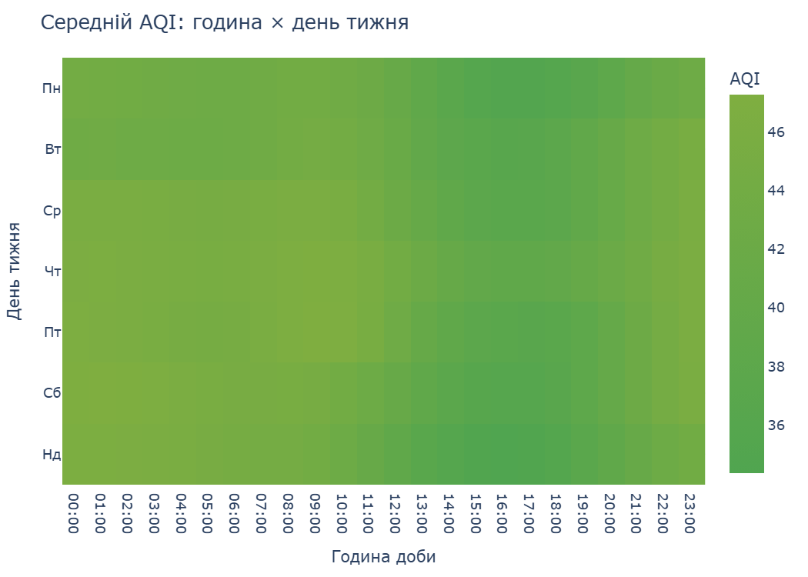
Найчистіше повітря вдень (близько 16:00), найбрудніше вночі й зранку. Різниця між буднями та вихідними майже непомітна.

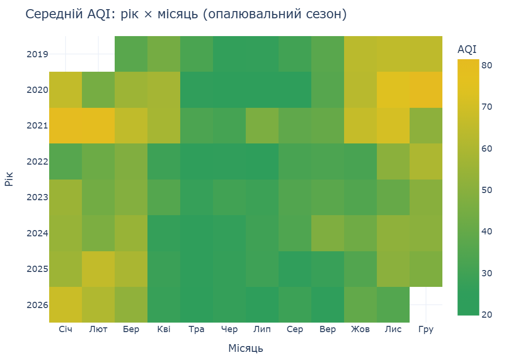
Опалювальний сезон: січень у середньому в 2,2 раза брудніший за травень.

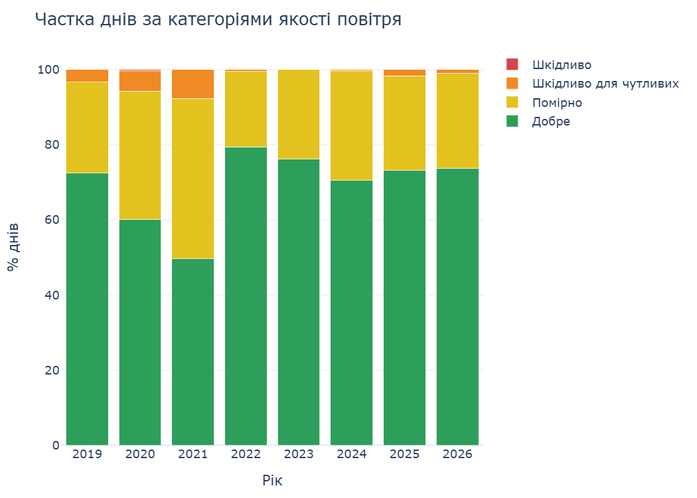
Частка днів за категоріями якості повітря по роках.

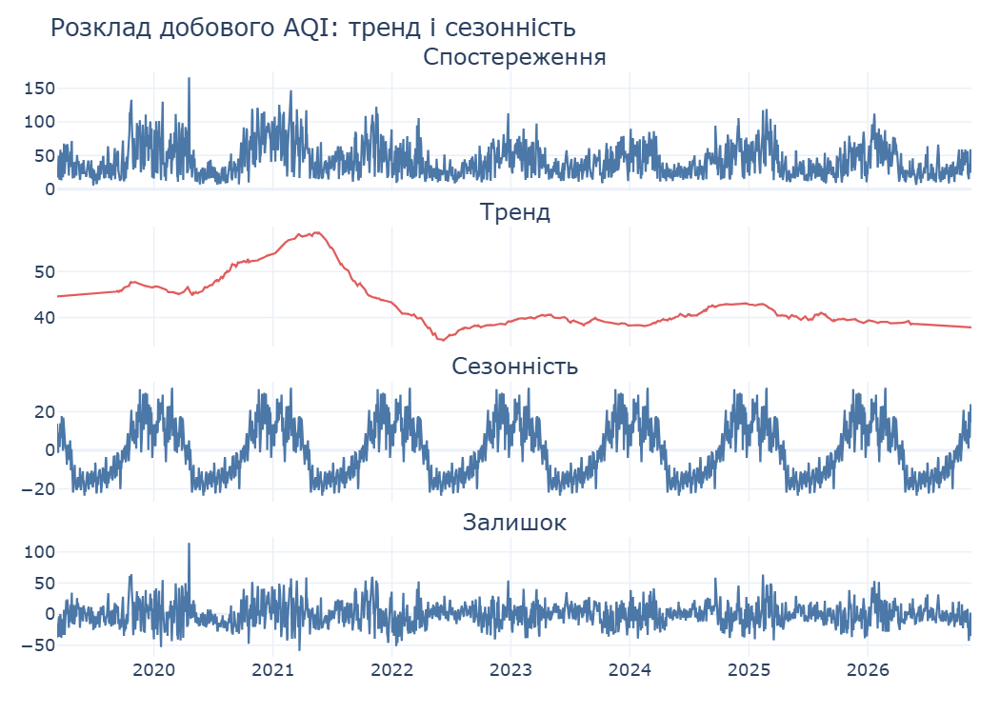
Розклад добового AQI на тренд, річну сезонність і залишок. Тренд показує пік 2020–2021 і помітне зниження у 2022 році; у наступні роки рівень майже не змінюється. Причини цих змін із самих даних не видно.

Також є профілі за годиною й днем тижня (`03_`, `04_`).

## Порівняння міст

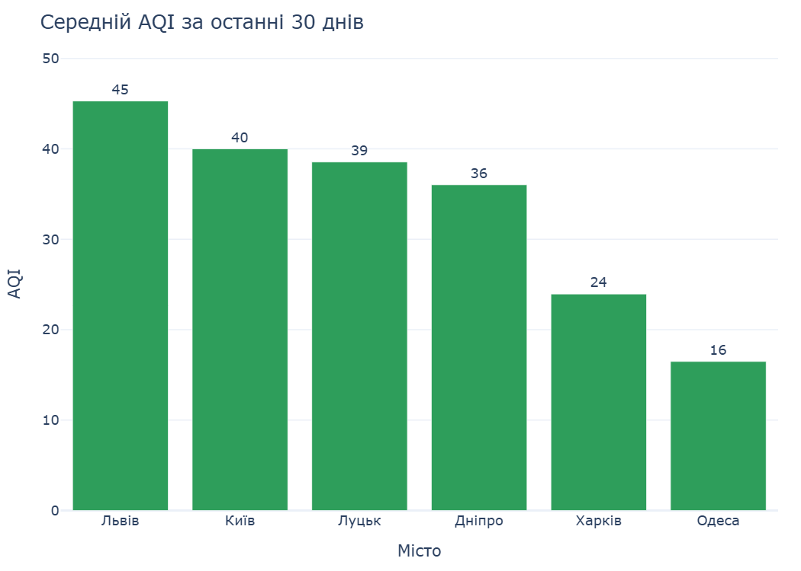
Середній AQI за 30 днів: найчистіше в Одесі та Харкові, найбрудніше у Львові.

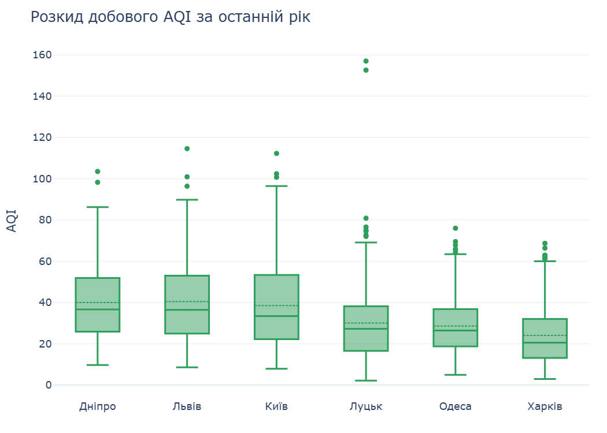
Розкид добового AQI за останній рік. Лише у Львові, Києві та Дніпрі трапляються дні вище 100. Для Луцька даних менше (з 2021 року).

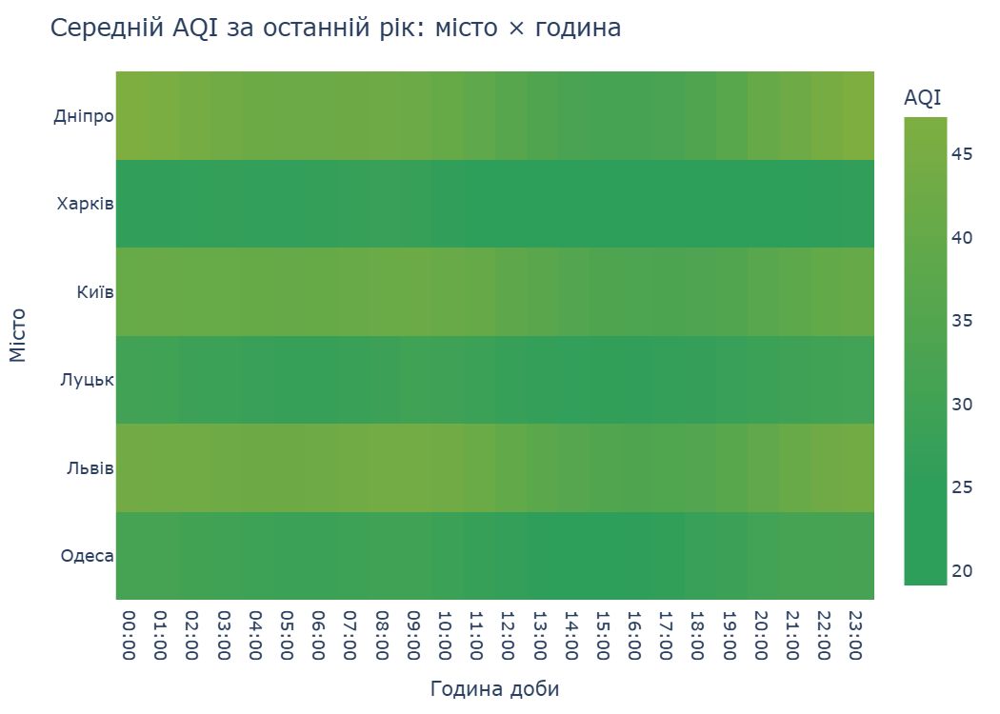

## Прогноз

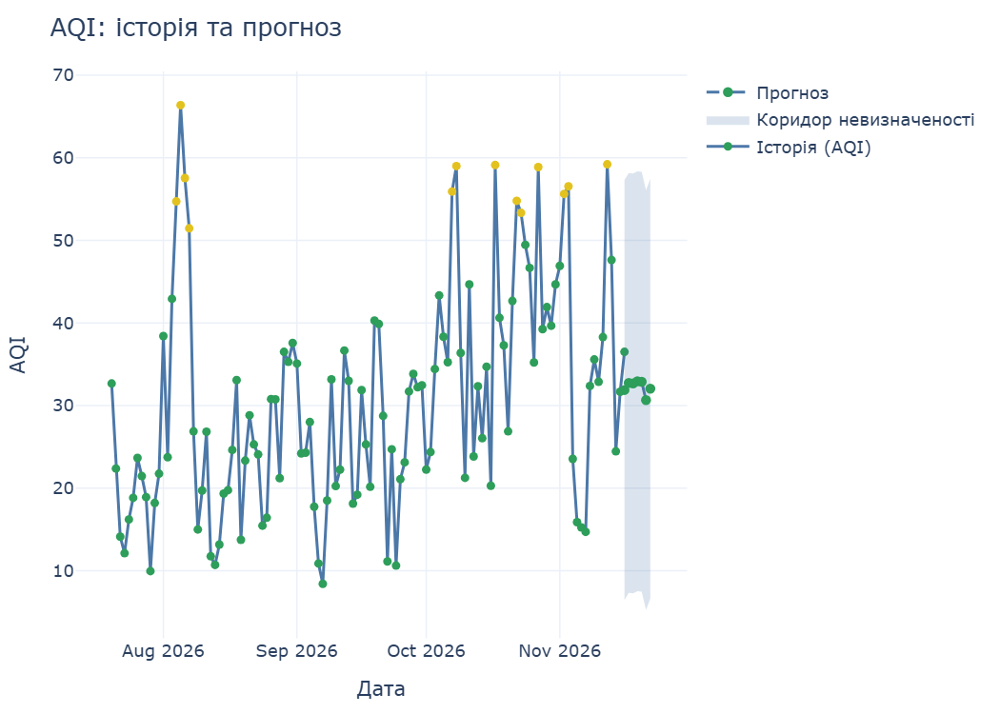
Прогноз на 7 днів із коридором 95%.

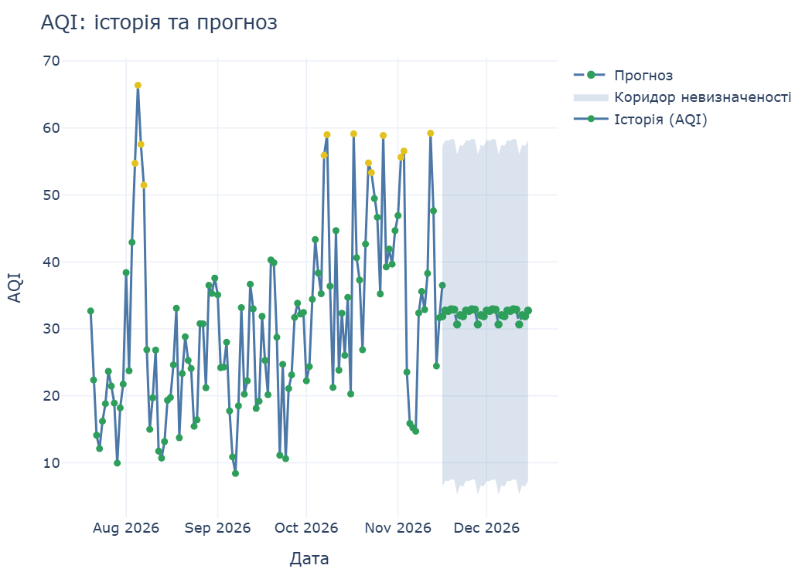
Довгий прогноз швидко «вирівнюється» до середнього рівня, а коридор лишається широким. Це чесний сигнал: далі кількох днів точно передбачити AQI неможливо.

### Наскільки йому можна вірити

Ми 8 разів «повертаємось у минуле»: прогнозуємо тиждень, який уже відомий, і порівнюємо з реальністю.

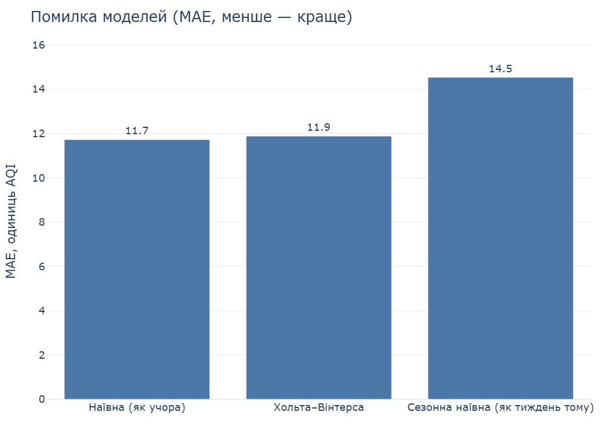
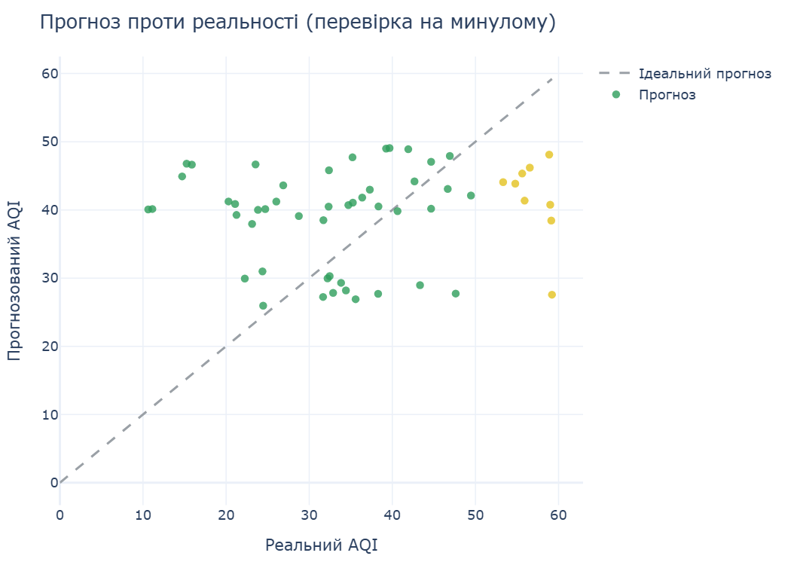

Модель порівнюється з двома простими еталонами: «буде як учора» і «буде як тиждень тому». Результат за всіма містами (MAE, одиниць AQI, менше — краще):

| Місто | як учора | як тиждень тому | Хольта–Вінтерса |
|---|---|---|---|
| Дніпро | **14,98** | 16,21 | 15,83 |
| Харків | 17,60 | 19,87 | **16,16** |
| Київ | **11,72** | 14,53 | 11,88 |
| Луцьк | 13,68 | 15,58 | **13,67** |
| Львів | 13,56 | 16,24 | **13,27** |
| Одеса | 8,27 | 8,47 | **7,69** |

## Висновки

- Головний чинник якості повітря в Україні за цими даними — **сезон**: взимку AQI у 2–3,5 раза вищий, ніж навесні.
- Протягом доби повітря найчистіше після обіду, найгірше вночі та зранку, тому гуляти найкраще близько 16:00.
- Добовий AQI дуже інерційний, тому проста модель «як учора» майже така сама точна, як модель Хольта–Вінтерса (остання виграє у 4 містах із 6, але з невеликою перевагою). Тижнева сезонність майже не допомагає: різниця між буднями й вихідними мізерна.
- Корисна частина прогнозу — не точка, а коридор: він чесно показує, наскільки ми не впевнені.

## Як працює прогноз

1. Погодинні значення AQI усереднюються до денних. Дні з менше ніж 12 вимірюваннями відкидаються, малі пропуски (до 3 днів) інтерполюються, береться останній рік.
2. Модель Хольта–Вінтерса з `statsmodels` (`ExponentialSmoothing`): згасаючий тренд плюс тижнева сезонність (період 7), якщо є не менше 28 днів, інакше без сезонності.
3. Коридор: `прогноз ± 1.96 × стандартне відхилення залишків` (приблизно 95%), нижня межа не менша за 0.
4. Якість: `rolling_backtest` відкладає останні N тижнів, прогнозує їх лише за попередніми даними й рахує MAE для моделі та двох еталонів.

## Структура

`loader.py` читання й чистка · `analysis.py` pandas-підрахунки · `forecast.py` прогноз, бектест, розклад · `charts.py` графіки plotly · `insights.py` тексти порад і висновки · `app.py` сайт · `report.py` звіт і PNG · `tests/` pytest · `CONTRACT.md` таблиця функцій · `outputs/` готові графіки.

Прогноз — статистична оцінка за історією вимірювань, а не медична порада.
